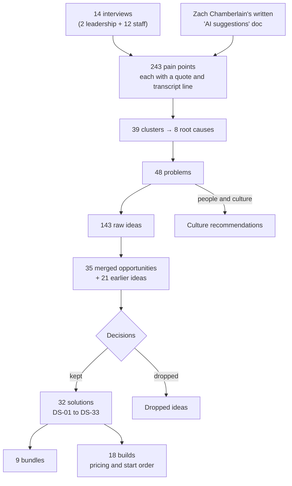
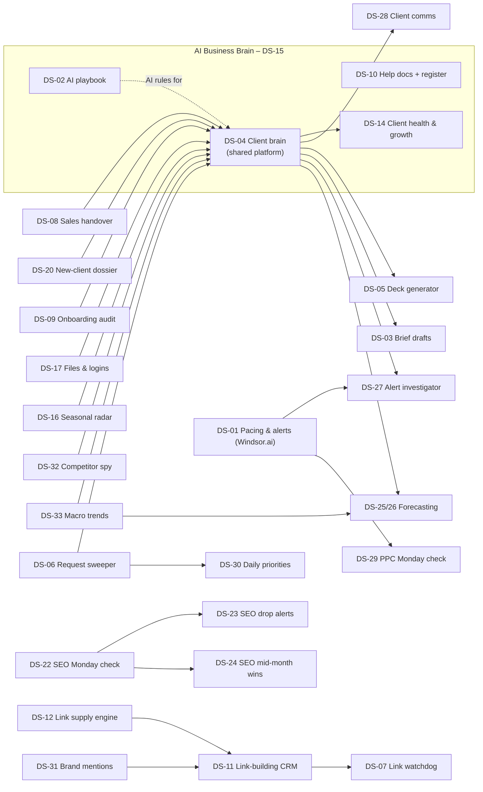

# Aperitif – AI & business audit: research repository

The full research behind the AI and business audit of **Aperitif**, a \~27-person Australian digital agency (paid media, SEO, content, link building). Audit by Austin Smith for Joe Romeo (founder), November 2026. Nothing is anonymised: names and roles are real.

It traces every recommendation back to what people said in interviews: transcripts → pain points → problems → opportunities → decisions → solutions → builds. Read [START-HERE.md](START-HERE.md) first.

## Contents

- [Builds and pricing](builds/README.md) – the 32 solutions delivered as 18 builds in 9 bundles, with prices, maintenance, running costs, dollar value and start order
- [Value by bundle](VALUE-BY-BUNDLE.md) – time saved, capacity, DLER, evidence and basis for every solution
- [How everything connects](#how-everything-connects)
- [How the solutions connect](#how-the-solutions-connect)
- [How it is organised](#how-it-is-organised)
- [How to read it](#how-to-read-it)
- [Using this repo with an AI tool](#using-this-repo-with-an-ai-tool)

## How everything connects

From interviews to recommendations. Every box is a folder in this repo; every arrow is a link you can follow in the files.

## How the solutions connect

Arrows show data flowing from one solution to another. The client brain (DS-04) is the shared platform: most solutions either write into it or read from it, which is why it is built first. New services and standalone tools (DS-18 landing pages, DS-19 AI receptionist, DS-21 creative tools) are not shown.

## How it is organised

| Folder | What is in it |
| --- | --- |
| [builds/](builds/README.md) | 18 builds – prices, maintenance, OpEx, dollar value, phases – plus `builds.csv` and `builds.json` |
| [solutions/](solutions/README.md) | One file per solution DS-01..DS-33, with front matter and the one-pager; index grouped by bundle. Pricing is in builds/ |
| [problems/](problems/README.md) | One file per problem P-01..P-48: decision, status, solutions, pain points with quotes, root cause |
| [pain-points/](pain-points/README.md) | All 243 pain points grouped by interview, plus `pain-points.csv` |
| [opportunities/](opportunities/README.md) | Merged opportunities O-01..O-35 and earlier ideas EI-01..EI-21, with decision and reason, plus CSV |
| [interviews/](interviews/README.md) | One folder per interview: transcript, extraction report, structured JSON |
| [synthesis/](synthesis/README.md) | Merge outputs: clusters, root causes, contradictions, opportunities, findings, culture and strengths |
| [method/](method/README.md) | How the research was done, and the conventions used for value and evidence |
| [pack/](pack/README.md) | The client pack pages: strengths, culture, scope and method, risks, assumptions, glossary, bundles |
| [data/](data/README.md) | Machine-readable JSON: solutions map, bundles, problems, pain points, interviews |

## How to read it

- **Browsing:** start at [START-HERE.md](START-HERE.md), open a bundle, then a solution. Each solution links to the problems it fixes; each problem lists its pain points with the quote, the person and a link to the exact transcript line.
- **Checking a claim:** follow the IDs down to the quote, then to the transcript. If a quote is interviewer-raised or inferred, it is labelled.
- **Status of anything:** each problem file, [pain-points.csv](pain-points/pain-points.csv) and [opportunities.csv](opportunities/opportunities.csv) carry the status and reason.

## Using this repo with an AI tool

If you load this repo into an AI tool, it is a structured evidence base. Use it like this.

**Layers (bottom to top):**

1. `interviews/<code>-<name>/transcript.md` – raw transcripts. Lines are numbered `L###`; `~mm:ss` is usually estimated.
2. **PP** pain points – `KO-PP01`, `SB-PP04` … The prefix is the interview code (SD = Shrishti Dokwal; KO = leadership kick-off; MP = leadership mid-point). Index: `pain-points/README.md`, data: `pain-points/pain-points.csv`.
3. **P** problems – `P-01`..`P-48` (Problems database). Several pain points roll up into one problem. Files: `problems/p-xx-*.md`. Stage 1 clusters are `C-xx`, root causes `RC-xx`, contradictions `X-xx` (`synthesis/`).
4. **O** merged opportunities – `O-01`..`O-35` (Stage 2), built from per-interview ideas such as `SB-O02`. **EI** – `EI-01`..`EI-21`, Austin's earlier ideas. Both in `opportunities/`.
5. **DS** solutions – `DS-01`..`DS-33`, the recommendations (`solutions/`). DS-13 is covered by DS-14 (Part B). The 32 solutions are delivered as 18 builds (`builds/`).
6. **X** contradictions – `X-01`..`X-31`: where two sources disagree (`synthesis/contradictions.md`). Also `WS-ZC-01` = Zach Chamberlain's written "AI suggestions" Google Doc (not in the repo).

**Following evidence:** down = DS front matter → `problems_fixed` → problem file → pain points → quote and transcript line. Up = pain point → its problem → the DS that fixes it (`status` / `addressed_by` in the CSV). `data/ds_map.json` is the solutions map.

**Source types of a pain point:**

- *staff-raised* (`interviewee`) – the person raised it themselves. Strongest evidence.
- *interviewer-raised* (`interviewer`) – Austin raised it and the person agreed. Not a staff raise; do not count it as independent support.
- *inferred* (`detected`) – drawn out by analysis, not stated. Treat as a hypothesis.

**Solution source types:** *evidence-backed* (rests on interview evidence), *mixed* (evidence plus Austin's additions), *Austin addition* (Austin's idea, weak or no interview evidence).

**Rules:**

- Cite IDs for every claim (e.g. "DS-06 fixes P-16; evidence SB-PP04, stated").
- Do not treat assumptions as facts. Current prices, maintenance, running costs and dollar values come from builds/README.md (18 builds); the research basis behind each value is in VALUE-BY-BUNDLE.md. Do not invent figures, and never add time and capacity together. Hour and dollar figures in the synthesis files are earlier research estimates; use builds/README.md for current figures.
- Decisions are not evidence. A *Not in proposal* problem stays out even if a solution "also helps".
- Where sources conflict, check `synthesis/contradictions.md` before stating a fact.
- The synthesis outputs (Stage 1–3, 6 Nov) came before the decisions; the problem, solution and build files are current.
- In the synthesis documents (`synthesis/`), **COI means conflict of interest** (Transpera could build the fix, or Austin has a link to it) – not cost of inactivity.

